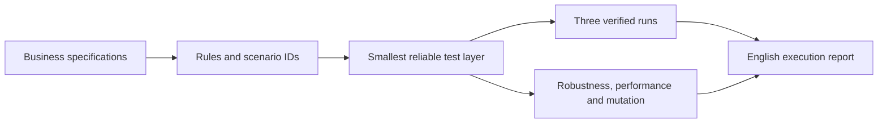

# Testes por Camadas

A reusable Codex skill for **spec-led test planning, implementation, and execution feedback**. It maps business rules to the lowest test layer that gives a reliable signal, then records what was actually verified.

Uma skill para mapear regras de negócio a partir das specs, escolher a stack de testes conforme a aplicação e criar uma suíte rápida com rastreabilidade legível em inglês.

## What it does

- Inspects the application's language, architecture, test setup, interfaces, and CI before choosing tools.
- Maps each specified rule and relevant variation to unit, component, contract, integration, or a small number of end-to-end tests.
- Keeps a business-readable traceability map and execution report in English, with stable rule and scenario IDs.
- Runs the relevant suite three times and records each outcome to expose instability.
- Checks robustness, application performance, suite duration, and mutation effectiveness where the specification and project support them.
- Reports gaps and residual risk. A high coverage or mutation score does not prove complete correctness.



## Install in Codex

Clone the repository into your user skills directory:

```bash
git clone https://github.com/ssavioRosa/testes-por-camadas.git ~/.codex/skills/testes-por-camadas
```

Or download the versioned ZIP from [Releases](https://github.com/ssavioRosa/testes-por-camadas/releases) and extract the `testes-por-camadas` folder into your skills directory. The folder must contain `SKILL.md` at its root. You can then ask Codex to use `$testes-por-camadas` in a repository with business specifications.

## Example request

> Use `$testes-por-camadas` to map and implement tests for the checkout flow in `specs/checkout.md`. Choose the test tools from this repository, generate English business traceability, run the relevant suite three times, and report mutation, robustness, performance, and remaining gaps.

## Files

| File | Purpose |
| --- | --- |
| [`SKILL.md`](SKILL.md) | Entry point and decision rules |
| [`references/decomposicao.md`](references/decomposicao.md) | How to assign scenarios to layers |
| [`references/registro-e-feedback.md`](references/registro-e-feedback.md) | Traceability and execution reporting |
| [`references/qualidade-da-suite.md`](references/qualidade-da-suite.md) | Stability, robustness, performance, and mutation |
| [`assets/business-test-traceability.md`](assets/business-test-traceability.md) | English traceability template |
| [`assets/test-execution-report.md`](assets/test-execution-report.md) | English execution report template |

The skill contains no application-specific business rules. It uses the target project's specs as the source of truth and asks for refinements when the expected behavior is unclear. It does not run a particular test framework or include an executable test script; those are selected and implemented for each application.

## License

MIT — see [LICENSE](LICENSE).
