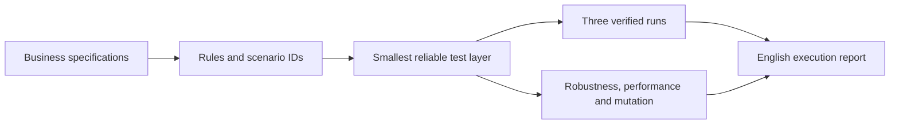

# Layered Testing Skill

A reusable Agent Skill for **Codex and Claude** focused on spec-led test planning, implementation, and execution feedback. It maps business rules to the lowest test layer that gives a reliable signal, then records what was actually verified.

Uma skill para mapear regras de negócio a partir das specs, escolher a stack de testes conforme a aplicação e criar uma suíte rápida com rastreabilidade legível em inglês.

## What it does

- Inspects the application's language, architecture, test setup, interfaces, and CI before choosing tools.
- Maps each specified rule and relevant variation to unit, component, contract, integration, or a small number of end-to-end tests.
- Keeps a business-readable traceability map and execution report in English, with stable rule and scenario IDs.
- Runs the relevant suite three times and records each outcome to expose instability.
- Checks robustness, application performance, suite duration, and mutation effectiveness where the specification and project support them.
- Reports gaps and residual risk. A high coverage or mutation score does not prove complete correctness.

## What happens when you invoke it

The mapping capability is implemented as instructions and templates in this skill. There is **no separate executable mapping agent**: Codex or Claude reads `SKILL.md`, inspects the target repository, chooses compatible tools, writes the map and tests, runs them, and reports evidence. A prompt alone cannot test an application that the assistant cannot access.

Give the assistant access to the application repository and identify the target: a spec file, flow, endpoint, event, or changed feature. You can simply ask it to **map** for a plan, or to **test/validate** for mapping, implementation, and execution. You do not need to choose the framework, test layer, or list all invalid inputs. The assistant should inspect the existing stack and contracts first.

| Stage | What the assistant does | What you receive |
| --- | --- | --- |
| Intake | Finds the target, specs/contracts, code, existing tests and CI; asks only for a missing source or a decision that changes expected behavior | Short scope and proposed approach |
| Mapping | Separates business rules from technical assurances; assigns each scenario an oracle and the cheapest reliable layer | English traceability map with stable IDs and gaps |
| Implementation | Adds or updates tests when requested, including boundary, invalid-input, state and failure cases relevant to the target | Test files and commands compatible with the application |
| Verification | Runs the relevant suite three times, checks meaningful mutations and measures applicable robustness/performance | English execution report with per-run evidence, findings and residual risk |

If a business rule is unclear, the assistant asks you to refine its specification. If a technical behavior is unclear, it identifies the missing contract or quality requirement. It can continue with independent cases while those decisions are pending. A mapped scenario is not reported as verified until its test has actually passed in the required runs.

For example, after a request to validate `POST /orders`, an initial reply might be: “I found the route, request schema, order service and current test runner. I will map the documented order rules and the API's technical contract separately, then implement the smallest tests that observe each risk. The schema does not say whether an unknown currency is rejected or defaulted; please specify that outcome in the contract. I can proceed with the documented cases now.” The exact reply depends on what the repository contains.

For an endpoint, the mapping includes the route, request and response schemas, parser and runtime validation, authorization, persistence and external effects. Candidate cases include missing or `null` fields, wrong types, values around documented limits, extreme numbers, oversized or nested payloads, malformed requests, generated inputs with reproducible seeds, failures and retries where relevant. Each test needs an independent expected result and must check that invalid operations do not produce unintended side effects. Business-rule coverage and technical-contract coverage are reported separately.



## Install and use in Codex

Clone the repository into your user skills directory:

```bash
git clone https://github.com/ssavioRosa/layered-testing-skill.git ~/.codex/skills/testes-por-camadas
```

Or download the versioned ZIP from [Releases](https://github.com/ssavioRosa/layered-testing-skill/releases) and extract the `testes-por-camadas` folder into your skills directory. The folder must contain `SKILL.md` at its root. In a repository with business specifications, invoke `$testes-por-camadas` and describe the flow to test.

## Install and use in Claude Code

For a personal skill available in all local Claude Code projects, clone this repository into Claude Code's personal skills directory:

```bash
git clone https://github.com/ssavioRosa/layered-testing-skill.git ~/.claude/skills/testes-por-camadas
```

Open Claude Code in the application repository and invoke the skill with `/testes-por-camadas`, followed by the task. Claude can also load it automatically when a request matches its description. To share the skill only within one application repository, place the extracted `testes-por-camadas` folder at `.claude/skills/testes-por-camadas/` and commit it there. The [`SKILL.md` format and these locations](https://code.claude.com/docs/en/skills) are supported by Claude Code.

## Install and use in Claude chat or Cowork

1. Download the latest `layered-testing-skill-v*.zip` from [Releases](https://github.com/ssavioRosa/layered-testing-skill/releases). Keep the ZIP intact; it contains the `testes-por-camadas` skill folder.
2. In Claude, enable **Code execution and file creation** (the newer settings may call this **Create and edit files**). Open **Customize > Skills** and choose **+ > Create skill > Upload a skill**. In the newer interface, **Customize** may appear as **Plugins**. Upload the ZIP and enable the skill.
3. Attach or provide access to the application repository and its business specifications. Ask Claude to use the `testes-por-camadas` skill for a specific flow, with the request shown below.

See Anthropic's [skill upload guide](https://support.claude.com/en/articles/12512180-use-skills-in-claude) and [interface rollout note](https://support.claude.com/en/articles/17740565-manage-plugins-skills-and-connectors-from-one-plugins-page). Claude chat and Cowork use the uploaded skill; local folders under `~/.claude/skills/` are for local Claude Code sessions and are [not read by cloud sessions](https://code.claude.com/docs/en/skills).

## Example requests

Codex:

> Use `$testes-por-camadas` to map and implement tests for the checkout flow in `specs/checkout.md`. Choose the test tools from this repository, generate English business traceability, run the relevant suite three times, and report mutation, robustness, performance, and remaining gaps.

Claude Code:

> `/testes-por-camadas` Map and implement tests for the checkout flow in `specs/checkout.md`. Generate English business traceability, run the relevant suite three times, and report mutation, robustness, performance, and remaining gaps.

Claude chat or Cowork:

> Use the `testes-por-camadas` skill to map and implement tests for the checkout flow in `specs/checkout.md`. Use the specification as the source of truth, generate English business traceability, run the relevant suite three times, and report mutation, robustness, performance, and remaining gaps.

New endpoint, in either tool:

> Use the `testes-por-camadas` skill to validate `POST /orders` in this repository. Inspect its schema, handler and side effects; map business rules separately from technical assurances. Implement fast tests for valid inputs, boundaries, invalid and generated inputs, authorization and failure handling where relevant. Verify that rejected requests leave no unintended state, run the relevant suite three times, and report the evidence and remaining gaps.

## Files

| File | Purpose |
| --- | --- |
| [`SKILL.md`](SKILL.md) | Entry point and decision rules |
| [`references/decomposicao.md`](references/decomposicao.md) | How to assign scenarios to layers |
| [`references/contratos-e-robustez.md`](references/contratos-e-robustez.md) | Endpoint and input-boundary test mapping |
| [`references/registro-e-feedback.md`](references/registro-e-feedback.md) | Traceability and execution reporting |
| [`references/qualidade-da-suite.md`](references/qualidade-da-suite.md) | Stability, robustness, performance, and mutation |
| [`assets/business-test-traceability.md`](assets/business-test-traceability.md) | English traceability template |
| [`assets/test-execution-report.md`](assets/test-execution-report.md) | English execution report template |

The skill contains no application-specific business rules. It uses the target project's specs for business behavior and identified schemas/contracts for technical guarantees, and asks for refinements when expected behavior is unclear. It does not contain a fixed test framework or an executable test script; those are selected and implemented for each application.

## License

MIT — see [LICENSE](LICENSE).
